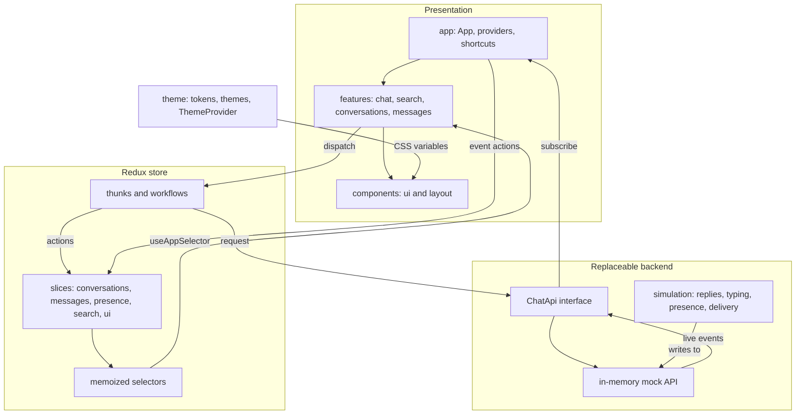

# Chats

A responsive, frontend-only messaging application in the style of WhatsApp Web and Slack, built as a
senior frontend take-home assessment. Direct and group conversations share one domain model, one
message list and one composer. A mock backend and a simulation stand in for a server, so the app
behaves like a live chat with no setup.

- **Requirement status:** [docs/requirements-checklist.md](docs/requirements-checklist.md) maps every
  requirement to its implementation and evidence, including what is incomplete.
- **Known gaps:** see [Known limitations and trade-offs](#known-limitations-and-trade-offs).

## Installation

You need Git, and Node 22.16.0, which is pinned in `.nvmrc`. `package.json` accepts
`^22.13.0 || >=24.0.0`, so Node 23 prints an engine warning.

```bash
git clone https://github.com/whitetposion/experiment-001.git
cd experiment-001
nvm use        # or install Node 22.16.0 another way
npm ci
npm run dev
```

Open <http://localhost:5173>. Vite takes the next free port if 5173 is in use, and prints the one it
chose. No environment variables, accounts or services are needed.

To run the production build:

```bash
npm run build
npm run preview    # serves it on http://localhost:4173
```

A fresh clone was installed and validated this way with Node 22.16.0 and npm 10.9.2 on macOS. Other
operating systems have not been tested.

## Development

| Command                | Purpose                             |
| ---------------------- | ----------------------------------- |
| `npm run dev`          | Start the development server        |
| `npm run build`        | Type-check and build for production |
| `npm run preview`      | Preview the production build        |
| `npm run typecheck`    | Type-check without building         |
| `npm run lint`         | Run ESLint                          |
| `npm run lint:fix`     | Run ESLint and apply fixes          |
| `npm run format`       | Format with Prettier                |
| `npm run format:check` | Check formatting                    |
| `npm test`             | Run Vitest in watch mode            |
| `npm run test:run`     | Run Vitest once                     |

### Keyboard shortcuts

| Keys                      | Action                                  |
| ------------------------- | --------------------------------------- |
| `Cmd` or `Ctrl` `K`       | Focus search, from anywhere             |
| `/`                       | Focus search, outside a text field      |
| `Enter`                   | Send, on a keyboard                     |
| `Shift` `Enter`           | New line                                |
| `Escape`                  | Clear search, or cancel a reply or edit |
| Arrow keys, `Home`, `End` | Move through chats and search results   |

### Component showcase

Run `npm run dev` and open <http://localhost:5173/showcase.html> to see every design-system
component and state in the light, dark and glass themes. Add `?theme=dark` or `?theme=glass` to open
on a theme. The page is not part of the production build.

### Trying loading and error states

Pass options to the backend in `src/main.tsx`, the one place that chooses it:

```ts
createSimulatedChatApi({ latencyMs: { min: 3000, max: 3000 } }) // hold loading states on screen
createSimulatedChatApi({ failureRate: 0.3 }) // fail three requests in ten
```

## Technology stack

| Technology                 | Version   | Used for                                                   |
| -------------------------- | --------- | ---------------------------------------------------------- |
| React                      | 19.3      | User interface                                             |
| TypeScript                 | 6.0       | Strict types, including branded IDs                        |
| Vite                       | 8.3       | Development server and build                               |
| Tailwind CSS               | 4.3       | Styling, with its default scales replaced by design tokens |
| Redux Toolkit, React Redux | 2.14, 9.3 | Shared state, entity adapters, thunks and a listener       |
| Radix UI                   | 1.8       | Accessible dialog, menu, avatar, tooltip and separator     |
| class-variance-authority   | 0.7       | Typed component variants                                   |
| React Hook Form            | 7.91      | The add members form                                       |
| Lucide React               | 1.68      | Icons                                                      |
| Vitest, Testing Library    | 5.1, 16.3 | Unit and interaction tests in jsdom                        |
| ESLint, Prettier           | 10, 3.9   | Type-aware linting, layer boundaries and formatting        |

The components in `src/components/ui` follow the shadcn/ui approach: they are project-owned wrappers
around Radix primitives. The shadcn CLI and its generated files are not used.

## Architecture



Requests flow down through thunks to the `ChatApi` interface. Live events flow back up through the
same interface, which is the slot a WebSocket would fill. Components never touch the backend, and
only `src/main.tsx` chooses it.

```
src/
  app/           Redux store, providers and application configuration
  components/
    ui/          Generic, reusable design-system components
    layout/      Application-level layout components
  features/      Feature-specific components, hooks, state and business logic
    conversations/
    messages/
    presence/
    chat/
    search/
    ui/
  theme/         Design tokens, theme definitions and theme provider
  services/
    mock-api/    Mock APIs
    simulation/  Simulations
    storage/     Empty placeholder. Nothing is persisted yet
  hooks/         Reusable hooks used by more than one feature
  lib/           Shared utilities
  types/         Shared TypeScript types
  test/          Test setup and utilities
  showcase/      Development-only component showcase
```

Git does not track empty folders, so a folder with no code yet holds a `.gitkeep`. Delete it when
the first real file lands.

## State management

Redux Toolkit holds state that several parts of the app share. There are five slices:

| Slice           | Holds                                                           |
| --------------- | --------------------------------------------------------------- |
| `conversations` | Conversation and participant entities, selection, query, filter |
| `messages`      | Message entities, and an ordered list of IDs per conversation   |
| `presence`      | Users, the current user, online status and typing               |
| `search`        | Message search result IDs and request status                    |
| `ui`            | Details panel, composer target and highlighted message          |

There is no group slice. Group operations update the same conversation entities as direct chats.

- **Normalized data.** Entities are stored once and refer to each other by ID, so an edit reaches the
  thread, the sidebar preview and every quoted reply with no syncing.
- **One action, several slices.** `sendMessage.fulfilled` stores the message, updates the
  conversation and clears the composer target. Each slice owns its response.
- **Few re-renders.** Lists select IDs and rows select their own data. `src/app/rendering.test.tsx`
  counts renders to prove it.
- **Local state stays local.** Drafts, open menus and dialogs live in components. The theme lives in
  its own provider.
- **Late responses are safe.** Reducers update only the fields a request owns, delivery status only
  moves forward, and stale search responses are ignored.

The full explanation is in [docs/state-management.md](docs/state-management.md).

## Domain model

The types live in `src/types`.

- **`Conversation`** is a union of direct and group, discriminated on `type`. Shared code handles
  either, and a direct conversation cannot carry a group name.
- **`Message`** is a union of active and deleted. A deleted message has no text field, so its content
  cannot leak into the UI, and the record stays so replies keep a valid target.
- **`ConversationParticipant`** joins a user to a conversation, with a role and read position.
- **`UserPresence`** is separate from `User`, because status changes often and profiles rarely do.
- **IDs are branded**, so passing a `ConversationId` where a `UserId` belongs is a compile error.

The entity diagram and rationale are in [docs/domain-model.md](docs/domain-model.md).

## Theme architecture

Theming is built in three tiers of CSS custom properties:

| Tier             | File                             | Role                                               |
| ---------------- | -------------------------------- | -------------------------------------------------- |
| Semantic tokens  | `src/theme/tokens.css`           | The contract, and the default light identity       |
| Component tokens | `src/theme/component-tokens.css` | Controls and panels, defaulting to semantic tokens |
| Tailwind bridge  | `src/theme/tailwind.css`         | Maps tokens to utilities and clears default scales |

`src/theme/themes.css` defines dark and glass by reassigning tokens. Glass is token values only, such
as translucent surfaces and backdrop blur, so no component has a glass variant. Tokens cover colors,
typography, spacing, borders, radii, shadows, gradients, opacity, blur and motion.

`ThemeProvider` sets `data-theme` from the user's preference, follows the system setting live, saves
the choice and keeps other tabs in step. A small script in `index.html` applies the theme before the
first paint. Motion tokens drop to `0ms` under `prefers-reduced-motion`.

Lint rejects hardcoded colors, and `src/theme/tokens.test.ts` fails on undefined or unused tokens. See
[docs/design-tokens.md](docs/design-tokens.md).

## Key architectural decisions

| Decision                                                    | Why                                                                             | Cost                                              |
| ----------------------------------------------------------- | ------------------------------------------------------------------------------- | ------------------------------------------------- |
| One `Conversation` type for direct and group                | One message list, composer and store, with no duplicated group engine           | Code that needs group fields must check `type`    |
| Backend behind a `ChatApi` interface                        | A real API replaces the mock in `src/main.tsx` with nothing above it changing   | More ceremony than calling mock data directly     |
| Thunks get the API through `extra`                          | Slices and components never know which backend runs, and tests inject their own | One extra level of indirection                    |
| The simulation writes through the mock backend              | Live events and later requests always agree                                     | The mock is larger than a list of fixtures        |
| Seed data in TypeScript, not JSON                           | The compiler checks it against the domain types and branded IDs                 | Departs from the brief's wording of mock JSON     |
| Redux slices split into slice, thunks, selectors, workflows | Data flow stays traceable and reducers stay pure                                | More files per feature                            |
| Layer boundaries enforced by ESLint                         | Dependencies only point down, and cycles fail lint                              | Some cross-feature needs route through `app`      |
| No router                                                   | The app has one screen. One history entry makes system back close a chat        | Chats have no shareable URLs                      |
| Message pages, without virtualization                       | 30 messages per page keeps the DOM small and scroll logic simple                | A very long loaded history would slow down        |
| Non-optimistic sending                                      | The mock is fast, and there is no pending message state to reconcile            | A slow real network would need optimistic sending |
| New messages animate with a transform                       | Scroll position stays exact, so tracking the end of the list stays reliable     | The animation is applied outside React            |

## Testing and verification

`npm run test:run` runs 595 tests in 42 files. They cover reducers, selectors, the mock API, the
simulation, render counts, themes and user interactions through Testing Library.

jsdom has no layout, so tests cannot prove responsive behavior. Those checks were made by driving
the production build in headless Chrome, as recorded in the
[requirement checklist](docs/requirements-checklist.md). That browser run is not an automated suite
in this repository.

## Known limitations and trade-offs

**Not implemented**

- Nothing is persisted. Reloading resets the data, because `services/storage` is an empty placeholder.
- Sending is not optimistic, so a message appears once the request succeeds. The `sending` status
  exists in the model but is never used.
- A message with the `failed` status has no retry. One seeded message shows the state. A send that
  really fails keeps its text in the composer and shows the error there.
- Leaving a group has no UI. The state logic and mock rules exist and are tested.
- Attachments are modeled in the types but not rendered.
- Older messages load through a button, not infinite scroll, and the list is not virtualized.
- Changing between the list and a chat on a phone has no animated transition.

**Shortcuts in the mock**

- All delays and people are simulated, and timings are shortened so the demo feels responsive.
- In a group, delivery status is one value for the whole group. Per-recipient tracking is not modeled.
- Search results do not refresh when new messages arrive.

**Not verified**

- Real devices. Mobile checks used Chrome device emulation, so the on-screen keyboard, safe-area
  insets, iOS Safari and real back gestures are implemented but untested.
- Firefox and Safari. The composer grows with `field-sizing`, which needs checking in both.
- Assistive technology. Roles and live regions are in place and tested, but no screen reader was used.
- Contrast was measured between token colors. Glass text over its gradient was checked by eye.

**Known rough edges**

- Secondary controls are smaller than the main 44px size: 36px icon buttons and 24px reaction chips.
- In the group panel, role badges do not line up between rows with and without a remove button.
- After reloading with a chat open, the first press of back does nothing.
- The production JavaScript is one 495 KB chunk (158 KB gzipped), which triggers Vite's size warning.
- `npm audit` reports 11 moderate findings, all in development lint tooling. Production dependencies
  have none.
- A few unused exports remain, such as `isApiError` and the `retryable` field.

## Import conventions

ESLint enforces these rules, so `npm run lint` fails on a violation.

- Use `./` for files in the same folder or below it, and `@/` for everything else. `../` is not
  allowed.
- Dependencies only point downwards. Each layer may import only from itself and the layers listed
  here:

| Layer               | May import                                                                                        |
| ------------------- | ------------------------------------------------------------------------------------------------- |
| `app`               | Everything except `test` and `showcase`                                                           |
| `features`          | `components`, `hooks`, `lib`, `services`, `theme`, `types`, `@/app/hooks`, `@/app/createApiThunk` |
| `components/layout` | `components/ui`, `hooks`, `lib`, `theme`, `types`                                                 |
| `components/ui`     | `hooks`, `lib`, `theme`, `types`                                                                  |
| `hooks`             | `lib`, `theme`, `types`                                                                           |
| `services`          | `lib`, `types`                                                                                    |
| `theme`             | `lib`, `types`                                                                                    |
| `lib`               | `types`                                                                                           |
| `types`             | Nothing                                                                                           |

- Each feature exposes its public API from `index.ts`. Other features import
  `@/features/messages`, never `@/features/messages/hooks/useMessages`. Inside its own folder, a
  feature uses its full `@/features/messages/...` path.
- Features read Redux types and typed hooks from `@/app/hooks`, never from `@/app/store`. The store
  imports feature slices, so this keeps the dependency one-way at runtime.
- Features depend on each other in one direction: `chat`, then `search`, then `ui`, then
  `conversations`, then `messages`, then `presence`.
- `app` composes features. If two features need to talk to each other, move the shared part down a
  layer or compose them in `app`. Circular imports fail lint through `import-x/no-cycle`.
- Tests and `src/test` may import from any layer. Production code must not import `@/test`.
- `src/showcase` may import shared UI layers but not features, and nothing may import it.
