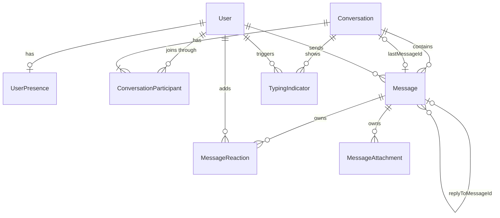

# Domain model

The types live in `src/types`. Features share them, and no feature owns them, so `conversations`
and `messages` never need to import each other.

| Type                      | Relationship                                                         |
| ------------------------- | -------------------------------------------------------------------- |
| `Conversation`            | A direct or group conversation. References users and messages by ID  |
| `ConversationParticipant` | Joins a user to a conversation, with their role and read position    |
| `Message`                 | Belongs to one conversation and one sender, and may reply to another |
| `MessageReaction`         | Part of a message. Holds the reacting user's ID                      |
| `MessageAttachment`       | Part of a message                                                    |
| `UserPresence`            | One per user. Online status and last seen                            |
| `TypingIndicator`         | Temporary. One user typing in one conversation                       |

## Design decisions

**Direct and group conversations are one entity.** `Conversation` is a discriminated union on
`type`. Shared code handles any conversation, and checking `type` unlocks the group fields. A direct
conversation cannot carry a group name, and a group cannot omit one. There is no separate group
store or message model.

**A direct conversation has no title field.** Its name and avatar come from the other participant,
so a profile change shows up everywhere without syncing.

**`participantIds` and `ConversationParticipant` both exist.** `participantIds` answers who is in a
conversation, which most screens need. `ConversationParticipant` holds the details that only some
screens need, such as role and read position. Adding or removing a member must update both.

**Messages are separate from conversations.** A message points to its conversation through
`conversationId`, and a conversation never contains its messages. Loading, paging or updating one
message does not touch the conversation.

**Other references are IDs too.** `lastMessageId` and `replyToMessageId` store IDs, not copies. The
sidebar preview and quoted replies are derived, so an edit or delete appears everywhere at once. A
replied-to message may not be loaded yet, so a lookup must handle it being missing.

**Reactions and attachments stay inside their message.** They have no life of their own: they are
read with the message, and they go when it goes. Their user references are still IDs. Only messages
are too large or independent to nest.

**Deleted messages are a separate state.** `DeletedMessage` has no text, reactions or attachments,
so deleted content cannot leak into the UI. The record stays because replies and previews may point
to it, and it lets the UI show "This message was deleted".

**Delivery status and read position answer different questions.** `deliveryStatus` drives the
sender's ticks. In a group, `delivered` and `read` mean every recipient has reached that state.
`lastReadMessageId` on each participant records how far that person has read, which also supports
"seen by" without storing a row per message per user.

**Unread information is stored, not derived.** Older messages may not be loaded, so counting them
would give the wrong number. `unread` describes the signed-in user only.

**Presence is separate from `User`.** Presence changes constantly and profiles rarely do. Keeping
them apart stops a status change from re-rendering everything that reads a profile.

**Typing indicators expire.** `connectChatEvents` clears an indicator at `expiresAt` if the stop
event never arrives.

**IDs are branded.** They are strings at runtime, but the compiler rejects a `ConversationId` where
a `UserId` belongs. Data from outside, such as mock JSON, enters through `toUserId` and the other
constructors.

**Timestamps are ISO strings.** Redux state must stay serializable, and JSON has no date type.

**Values are required and nullable, not optional.** `avatarUrl: string | null` makes every record
state its value, so a forgotten field is a compile error.

**Unions replace enums.** `erasableSyntaxOnly` rejects `enum`, and unions match the JSON values
directly. Everything is `readonly`, because state changes go through reducers.

## Rules the types cannot enforce

Reducers and services own these, and their tests should cover them:

- A user has at most one reaction on a message. Choosing another emoji replaces it.
- Delivery status only moves forward: `sending`, `sent`, `delivered`, `read`. `failed` follows
  `sending`, and a retry returns to `sending`.
- Only the sender can edit or delete a message.
- `participantIds` matches the conversation's `ConversationParticipant` records.
- A group has at least one owner.
